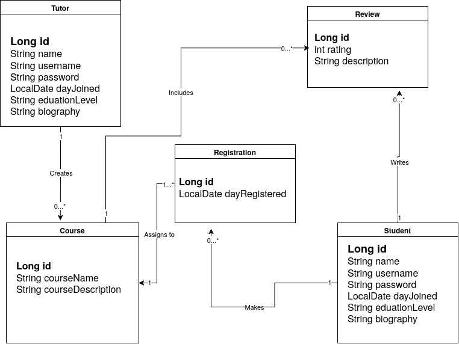

# TutorMatch backend API

# UML Class Diagram



# API Overview

**Version:** 1.0
**Last Updated:** October 23, 2026

**Base URL:**

- local: http://localhost:8080/api
- production: https://tutormatch-kggr.onrender.com/api

JSON request bodies are validated. The endpoint tables list applicable error
codes: `400 Bad Request` for invalid input, `404 Not Found` for missing
resources, and `409 Conflict` for duplicate records or invalid state
transitions.

## Profile and discovery

| Method | Path                            | Purpose                                                    | Response code | Error codes | User story                                                              |
| ------ | ------------------------------- | ---------------------------------------------------------- | ------------- | ----------- | ----------------------------------------------------------------------- |
| `POST` | `/api/students`                | Register a student profile                                | `201 Created` | `400, 409`  | [US-1](../docs/TutorMatchSRS.md#L44)
| `GET`  | `/api/students`   | Read all student profiles                                    | `200 OK`      | `404`       | [US-1](../docs/TutorMatchSRS.md#L44)                                      |                                      |
| `GET`  | `/api/students/{studentId}`   | Read a student profile                                    | `200 OK`      | `404`       | [US-1](../docs/TutorMatchSRS.md#L44)                                      |
| `PUT`  | `/api/students/{studentId}`   | Update a student profile                                  | `200 OK`      | `400, 404, 409` | [US-1](../docs/TutorMatchSRS.md#L44)                                   |
| `POST` | `/api/tutors`                 | Register a tutor profile                                 | `201 Created` | `400, 409`  | [US-5](../docs/TutorMatchSRS.md#L85)
| `GET`  | `/api/tutors/`     | Read all tutor profiles                                     | `200 OK`      | `404`       | [US-5](../docs/TutorMatchSRS.md#L85)                                      |                                      |
| `GET`  | `/api/tutors/{tutorId}`     | Read a tutor profile                                     | `200 OK`      | `404`       | [US-5](../docs/TutorMatchSRS.md#L85)                                      |
| `PUT`  | `/api/tutors/{tutorId}`     | Update a tutor profile                                   | `200 OK`      | `400, 404, 409` | [US-5](../docs/TutorMatchSRS.md#L85)                                   |

### Example Customer Request

```http
POST /api/students
Content-Type: application/json

{
  "name": "John Doe",
  "username": "jonnyboy",
  "password": "securePassword123",
  "password": "youshouldprobablyguess",
  "dayJoined": "2017-08-08",
  "educationLevel": "B.S. Computer Science",
  "biography": "I didn't write this code at all. I'm stuck in this database, I shall live forever in persistent storage, help me!"
}
```

## Services and availability

| Method   | Path                                                     | Purpose                                                             | Response code    | Error codes | User story                          |
| -------- | -------------------------------------------------------- | ------------------------------------------------------------------- | ---------------- | ----------- | ----------------------------------- |
| `POST`   | `/api/services`                     | Add a course                           | `201 Created`    | `400, 404`  | [US-8](../docs/TutorMatchSRS.md#L116) |
| `POST`   | `/api/students/{studentId}/courses`                    | Add a registration for a course                                      | `201 Created`    | `400, 404`  | [US-4](../docs/TutorMatchSRS.md#L74)  |


### Example Service Request

```http
POST /api/students/{trainerId}/courses
Content-Type: application/json

{
    "dayRegistered": "2020-06-15",
    "studentId": 1,
    "courseId": 1
}
```